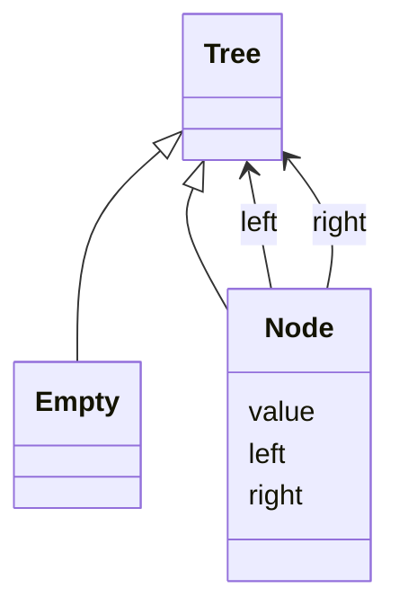
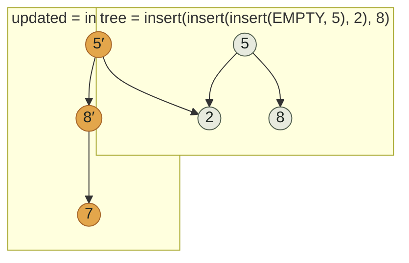
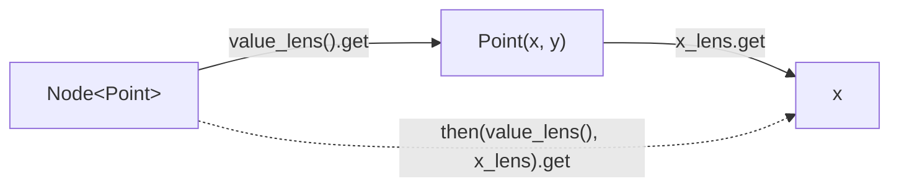

# safe_tree

A purely functional, immutable tree for Python. Every operation returns a
new tree; nothing is ever mutated in place. Updates share structure with
the tree they were built from instead of copying it, and
[lenses](#lenses) give you precise, composable updates without
hand-written recursive reconstruction.

```python
from safe_tree import EMPTY, insert, member, in_order

tree = insert(insert(insert(EMPTY, 5), 2), 8)
member(tree, 2)          # True
list(in_order(tree))     # [2, 5, 8]
```

## Why

- **Immutable by construction.** `insert`, `delete`, `map_tree`, and
  `filter_tree` all return a new tree. The one you started with is still
  there, unchanged, for as long as you hold a reference to it.
- **Structural sharing, not copying.** An update only allocates the nodes
  on the path to the change — see [below](#structural-sharing).
- **No behavior hides in classes.** Data lives in frozen structs
  (`Node`, `Lens`); every operation is a plain function over that data.
- **Typed end to end.** `mypy --strict` clean, no implicit `Any`.

## Install

Not yet published to PyPI. With [uv](https://docs.astral.sh/uv/):

```sh
uv add git+https://github.com/mateodiazs/safe_tree
```

## The shape of a tree

A `Tree[A]` is either `Empty`, or a `Node[A]` holding a value and two
child trees:



`A` is the value type, shared by `Tree[A]`, `Node[A]`, and `Node.value` —
omitted above only because Mermaid's class diagrams don't render Python
generics cleanly. There's exactly one `Empty` — the module-level
`EMPTY` — and it's never mutated or recreated, so emptiness is always
the same object.

## Structural sharing

`insert` and `delete` only copy the nodes on the path to the change.
Inserting `7` into a tree rooted at `5` never touches the left subtree,
so the new tree's left child is the *same object* as the old tree's:



Node `2` is drawn once because it's referenced by *both* trees — not
duplicated. This is exactly what `tests/test_sharing.py` asserts with
`is`, not just `==`:

```python
tree = insert(insert(insert(EMPTY, 5), 2), 8)
updated = insert(tree, 7)
assert tree.left is updated.left  # the same object, not a copy
```

The same identity-preserving behavior holds for `delete`: deleting a
value that isn't present returns the original tree unchanged, by
identity, not an equal-but-new one.

## Lenses

A `Lens[S, A]` is a frozen struct holding a pure `get` and `put` pair
focused on part `A` of a whole `S`. `then` composes two lenses so you can
reach straight through a node into a field of its own payload:



```python
from dataclasses import dataclass
from safe_tree import EMPTY, Lens, Node, then, value_lens

@dataclass(frozen=True, slots=True)
class Point:
    x: int
    y: int

x_lens: Lens[Point, int] = Lens(
    get=lambda p: p.x,
    put=lambda p, x: Point(x, p.y),
)

node = Node(Point(1, 2), EMPTY, EMPTY)
node_x = then(value_lens(), x_lens)

node_x.get(node)            # 1
node_x.put(node, 9).value   # Point(x=9, y=2)
```

`value_lens`, `left_lens`, and `right_lens` are generic functions, not
pre-built values — call them (`value_lens()`), don't reference them
bare, so `mypy` can resolve the type parameter at each use site.

Lenses here focus on a node's own fields (`value`, `left`, `right`),
which are always present and so always safe to get/put. A tree position
several levels down may or may not exist — that's inherently partial,
which is why there's no general `path_lens`; combine a lens with
ordinary pattern matching for that case.

## API

| | |
|---|---|
| `insert(tree, value)` | New tree with `value` added. |
| `delete(tree, value)` | New tree with `value` removed. |
| `member(tree, value)` | Membership test. |
| `map_tree(tree, f)` | Structure-preserving map over every value. |
| `fold(tree, f, init)` | In-order reduction to a single value. |
| `filter_tree(tree, pred)` | Rebuild keeping only matching values. |
| `in_order` / `pre_order` / `post_order` | Lazy traversal iterators. |
| `size(tree)` / `depth(tree)` | Structural measures. |
| `Lens`, `then`, `value_lens`, `left_lens`, `right_lens` | Composable node accessors. |

Full API reference (generated from the same Google-style docstrings
shown above) via [pdoc](https://pdoc.dev):

```sh
uv run pdoc -o docs safe_tree
```

## Development

```sh
uv sync --all-extras
uv run ruff check .      # lint
uv run ruff format .     # format
uv run mypy src tests    # strict type-check
uv run pytest            # tests, incl. doctests and hypothesis properties
```

## Looking toward ML

Nothing here is ML-specific yet, but the shape is deliberately kept
compatible with it: a frozen, tagged-union tree is close to what JAX's
`pytree` / `optree` protocols expect, and structural sharing makes
keeping every intermediate version of a dataset or a split cheap in
memory. Not in scope today — noted so early API choices don't foreclose
it later.
